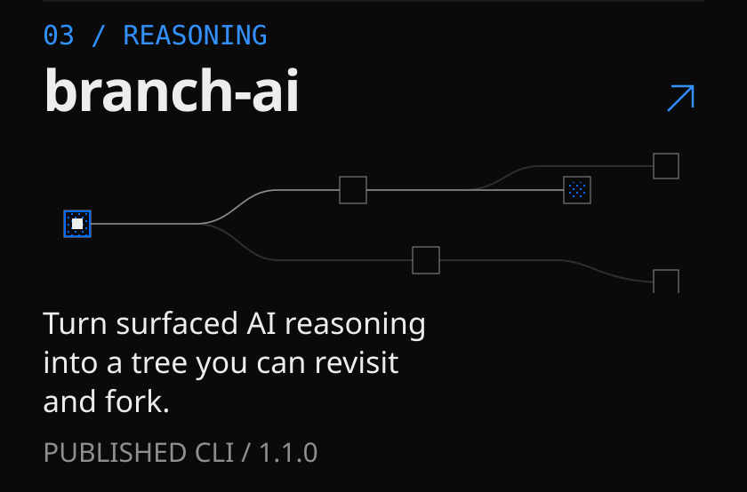
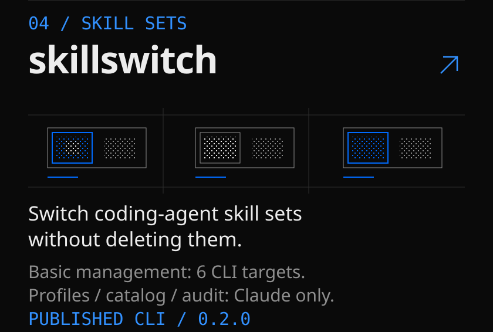
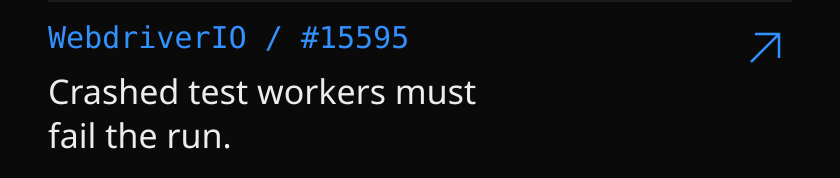
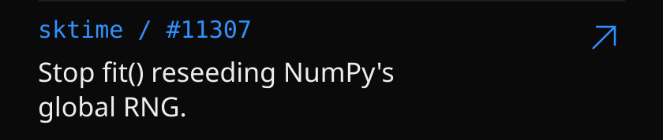
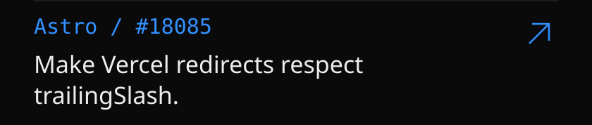

<!-- Image-only profile. Accessible full text and dated sources: EVIDENCE.md. Original banner.svg retained unchanged. -->

<picture><source media="(prefers-reduced-motion: reduce)" srcset="assets/profile-hero-static.svg"></picture>
<picture><source media="(prefers-reduced-motion: reduce)" srcset="assets/profile-intro-static.svg"></picture>
<a href="https://github.com/nikolas-sapa/ns-ui"><picture><source media="(prefers-reduced-motion: reduce)" srcset="assets/profile-ns-ui-static.svg"></picture></a>
<a href="https://github.com/nikolas-sapa/grip-browser"><picture><source media="(prefers-reduced-motion: reduce)" srcset="assets/profile-grip-static.svg"></picture></a>
<a href="https://github.com/nikolas-sapa/branch-ai"><picture><source media="(prefers-reduced-motion: reduce)" srcset="assets/profile-branch-static.svg"></picture></a>
<a href="https://github.com/nikolas-sapa/skillswitch"><picture><source media="(prefers-reduced-motion: reduce)" srcset="assets/profile-skillswitch-static.svg"></picture></a>

<a href="https://github.com/nikolas-sapa/resumed-agent-staleness"><picture><source media="(prefers-reduced-motion: reduce)" srcset="assets/profile-research-static.svg"></picture></a>

