<!-- Text-forward profile. Full project ranking, extended detail and dated sources: EVIDENCE.md. -->

**Latest:** 4th of 47 teams at the [Gen AI Summit Hackathon](https://hackathon.polymath42.com/), Athens (Nov 2026). Built FIREYE with Marco Serat; pitched the finals to Google Maps co-creator Lars Rasmussen → [repo](https://github.com/nikolas-sapa/FIREYE) · [live demo](https://nikolas-sapa.github.io/FIREYE/console.html?view=civilian)

**Open to internships** at VC-backed startups (YC/Speedrun preferred) → [contact](https://nikolassapalidis.tech/contact)

### Projects

| # | project | what it does |
|---|---|---|
| ★ | [**FIREYE**](https://github.com/nikolas-sapa/FIREYE) | wildfire intel for residents — fire map, simulated alerts, safer routes (simulation) · *4th of 47, Gen AI Summit* |
| 1 | [**ns-ui**](https://github.com/nikolas-sapa/ns-ui) | 542 React components installed as editable source · CLI + MCP |
| 2 | [**Grip**](https://github.com/nikolas-sapa/grip-browser) | CDP-native browser SDK for agents · 16× smaller snapshots · PyPI |
| 3 | [**Staleness research**](https://github.com/nikolas-sapa/resumed-agent-staleness) | 2,631-run study on stale agent summaries overruling fresh data |
| 4 | [**SAC Capital**](https://github.com/nikolas-sapa/sac-capital) | LLM equity research + paper trading, on-chain decision commitments |
| 5 | [**Agentic Pipeline**](https://github.com/nikolas-sapa/agentic-pipeline) | durable event-driven LLM jobs · queue, retry/DLQ/replay |
| 6–24 | **+19 more** — Toolfence, Sigeval, Branch AI, Commitment Desk, Basis Terminal… · **new (Nov 2026):** [ossfit](https://github.com/nikolas-sapa/ossfit) (GitHub repo discovery by fit), [contribot](https://github.com/nikolas-sapa/contribot) (OSS contribution agent with enforced etiquette), [cinder](https://github.com/nikolas-sapa/cinder) (E2E-encrypted agent chat; pre-1.0, not externally audited) | [full ranking → EVIDENCE.md](EVIDENCE.md) |

*[co-train](https://github.com/nikolas-sapa/co-train) — agent-cost research, 6–8× lower cost per solved task in pre-registered runs — ended 18 Nov 2026: Anthropic shipped Code Mode, which does the core of it. Repo stays public as eval infrastructure.*

### Upstream · 44 merged PRs / 19 repos

| repo | merged |
|---|---|
| CapyMOA | 12 |
| WebdriverIO | 7 |
| neatroots · skepsis | 3 each |
| Cap · Omi · Presidio · river | 2 each |
| sktime · Astro · Traefik · ESLint Stylistic · UnoCSS · Mastra · Orca · git-extras · openclaw · kombu · ttt | 1 each |
| [all 44 merged →](https://github.com/search?q=is%3Apr+author%3Anikolas-sapa+is%3Amerged+-user%3Anikolas-sapa&type=pullrequests) | |

Reported a **high-severity auth bug in Convex Auth** — patched in 0.0.95 · [GHSA-c3rg-jwq9-3233](https://github.com/get-convex/convex-auth/security/advisories/GHSA-c3rg-jwq9-3233)

**Track record** — 8 client sites shipped Feb–Jun 2026 · fastest no-brief → live: **4 days** · iOS app in the App Store (PadelUp) · **2.8k npm downloads** across 3 tools

[nikolassapalidis.tech](https://nikolassapalidis.tech) · [X](https://x.com/NikolasSapa) · every claim above → dated sources in [EVIDENCE.md](EVIDENCE.md)
