<!-- Image-only profile. Selectable full text, project ranking and dated sources: EVIDENCE.md. Original banner.svg retained unchanged. -->

<picture><source media="(prefers-reduced-motion: reduce)" srcset="assets/profile-hero-static.svg">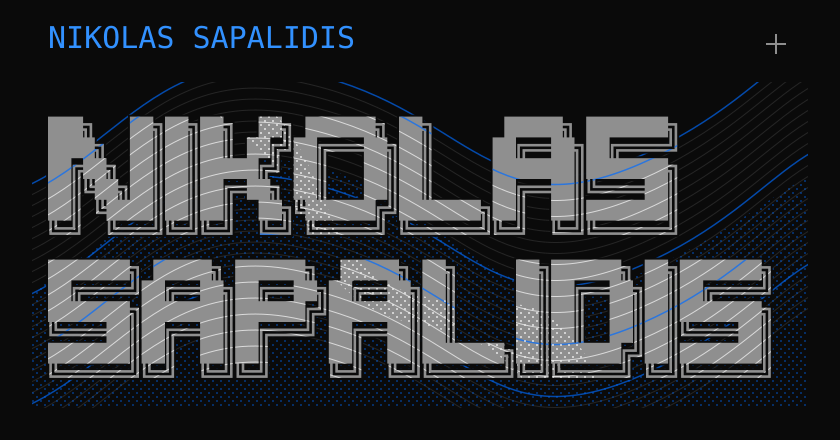</picture>
<picture><source media="(prefers-reduced-motion: reduce)" srcset="assets/profile-intro-static.svg">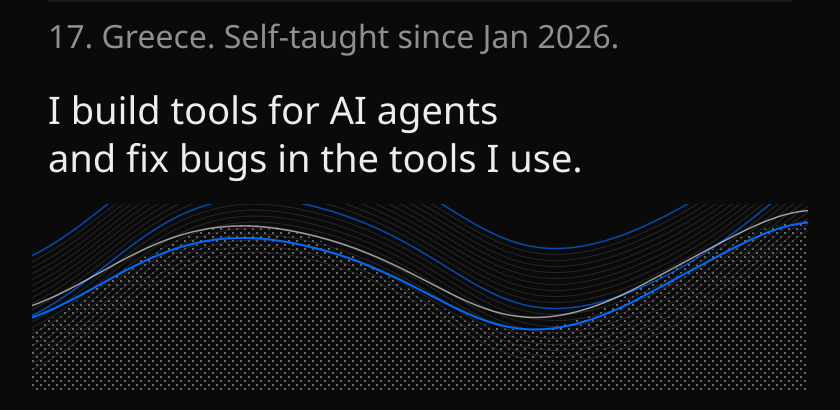</picture>
<a href="https://github.com/nikolas-sapa/ns-ui"><picture><source media="(prefers-reduced-motion: reduce)" srcset="assets/profile-ns-ui-static.svg">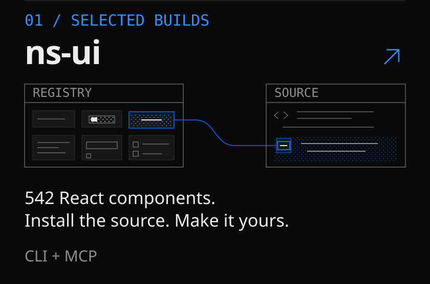</picture></a>
<a href="https://github.com/nikolas-sapa/grip-browser"><picture><source media="(prefers-reduced-motion: reduce)" srcset="assets/profile-grip-static.svg">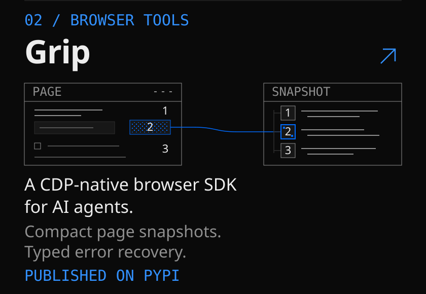</picture></a>
<a href="https://github.com/nikolas-sapa/sac-capital"><picture><source media="(prefers-reduced-motion: reduce)" srcset="assets/profile-sac-capital-static.svg">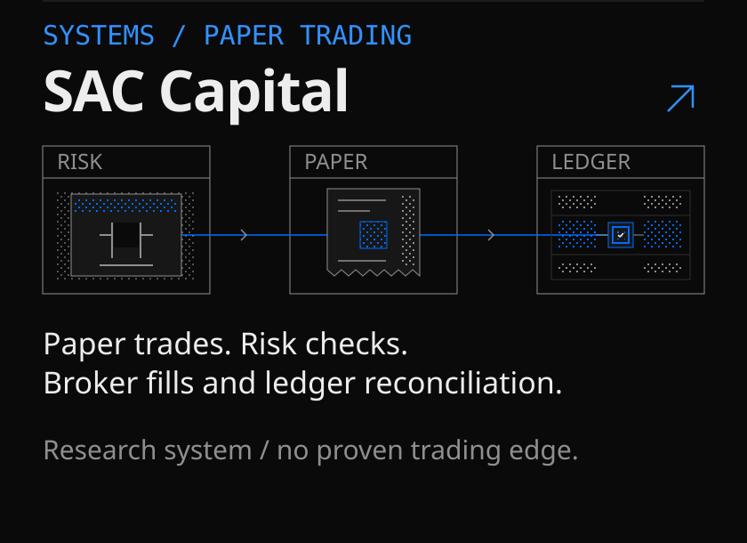</picture></a>
<a href="https://github.com/nikolas-sapa/agentic-pipeline"><picture><source media="(prefers-reduced-motion: reduce)" srcset="assets/profile-agentic-pipeline-static.svg">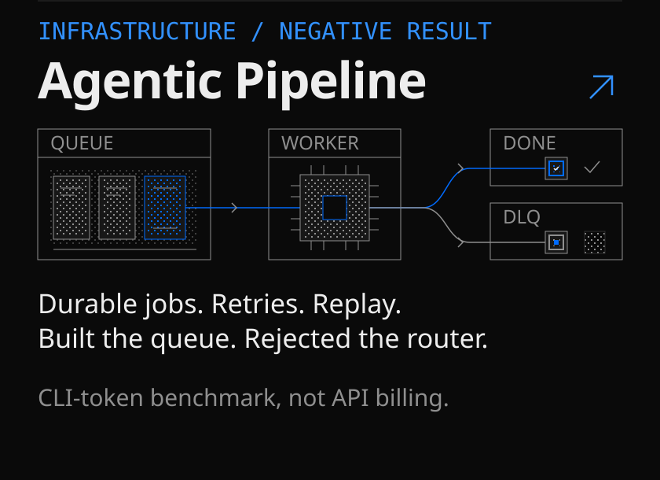</picture></a>
<a href="https://github.com/nikolas-sapa/resumed-agent-staleness"><picture><source media="(prefers-reduced-motion: reduce)" srcset="assets/profile-research-static.svg">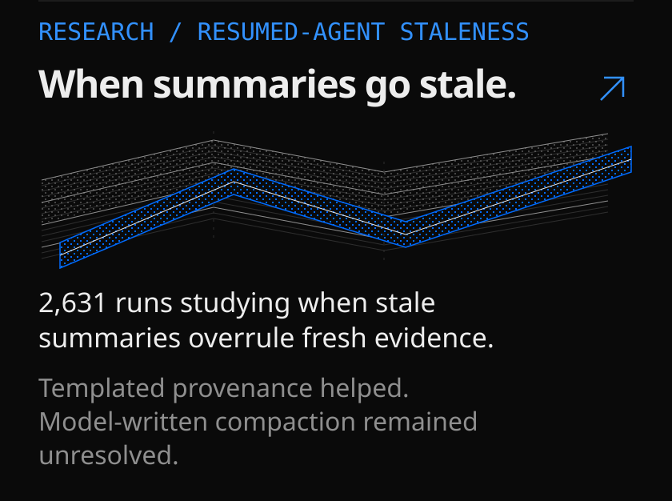</picture></a>
<picture>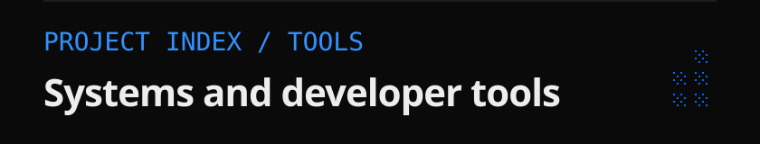</picture>
<a href="https://github.com/nikolas-sapa/toolfence">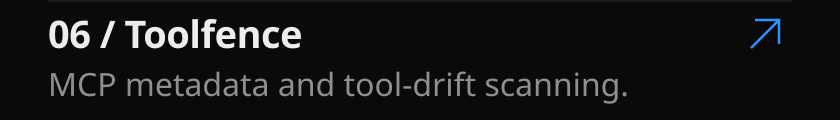</a>
<a href="https://github.com/nikolas-sapa/sigeval">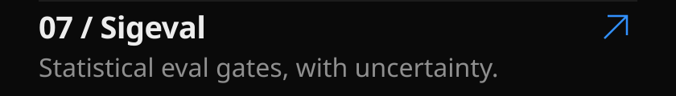</a>
<a href="https://github.com/nikolas-sapa/branch-ai">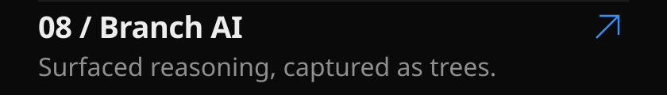</a>
<a href="https://github.com/nikolas-sapa/helm">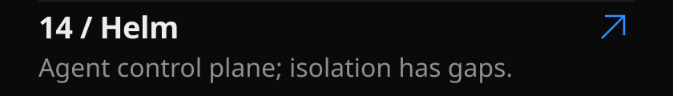</a>
<a href="https://github.com/nikolas-sapa/skillswitch">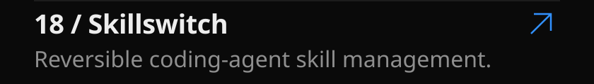</a>
<picture>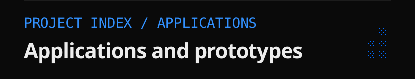</picture>
<a href="https://github.com/nikolas-sapa/commitment-desk">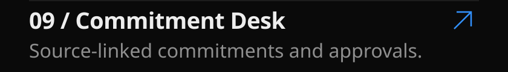</a>
<a href="https://github.com/nikolas-sapa/basis-terminal">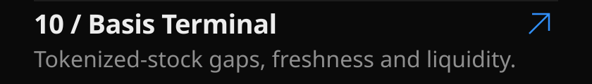</a>
<a href="https://github.com/nikolas-sapa/open-agent-order-evidence-2026">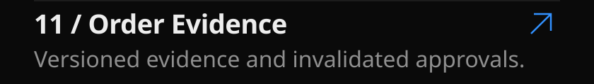</a>
<a href="https://github.com/nikolas-sapa/taste-concierge">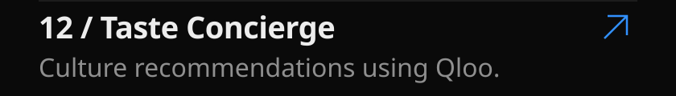</a>
<a href="https://github.com/nikolas-sapa/scope-to-deposit-paypal-ai-2026">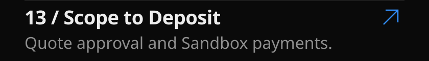</a>
<a href="https://github.com/nikolas-sapa/neurolens">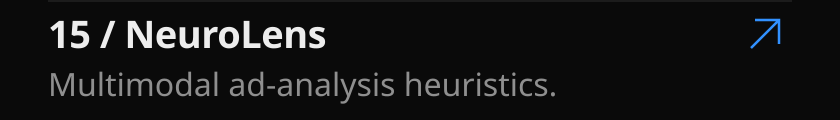</a>
<a href="https://github.com/nikolas-sapa/release-memory-graph-hacks-2026">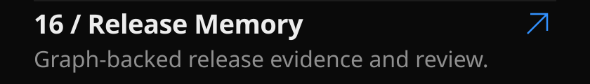</a>
<a href="https://github.com/nikolas-sapa/clientcast">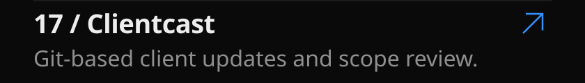</a>
<picture>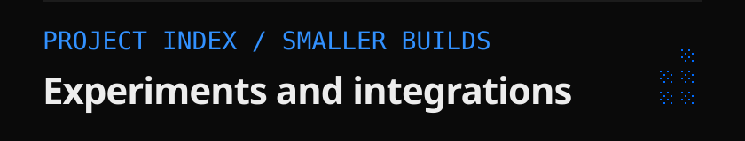</picture>
<a href="https://github.com/nikolas-sapa/nemocascade">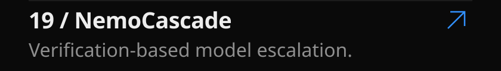</a>
<a href="https://github.com/nikolas-sapa/curb">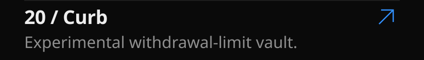</a>
<a href="https://github.com/nikolas-sapa/x402-bounty-radar">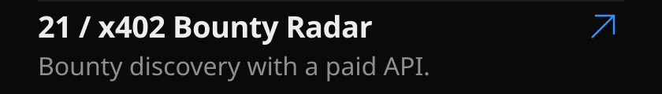</a>
<a href="https://github.com/nikolas-sapa/fieldquest">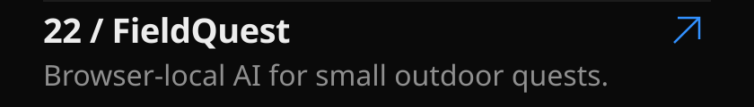</a>
<a href="https://github.com/nikolas-sapa/branch-obsidian">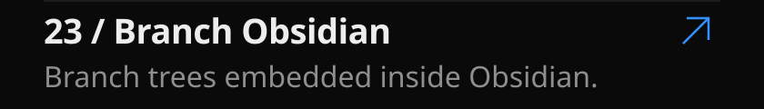</a>
<a href="https://github.com/nikolas-sapa/pre-commit-deno">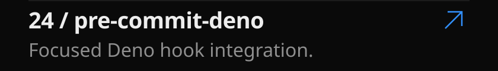</a>
<a href="https://github.com/search?q=is%3Apr+author%3Anikolas-sapa+is%3Amerged+-user%3Anikolas-sapa&amp;type=pullrequests">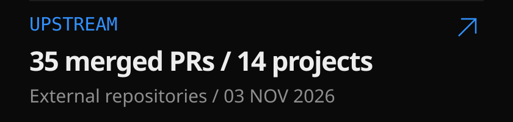</a>
<picture>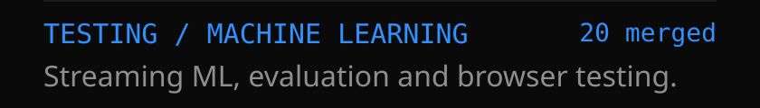</picture>
<a href="https://github.com/adaptive-machine-learning/CapyMOA/pulls?q=is%3Apr+is%3Amerged+author%3Anikolas-sapa">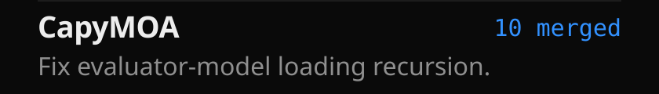</a>
<a href="https://github.com/webdriverio/webdriverio/pulls?q=is%3Apr+is%3Amerged+author%3Anikolas-sapa">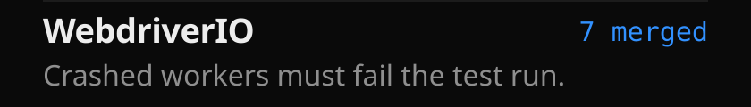</a>

<a href="https://github.com/online-ml/river/pulls?q=is%3Apr+is%3Amerged+author%3Anikolas-sapa">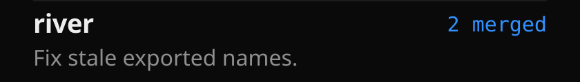</a>
<picture>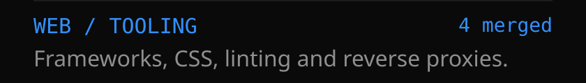</picture>
<a href="https://github.com/withastro/astro/pulls?q=is%3Apr+is%3Amerged+author%3Anikolas-sapa">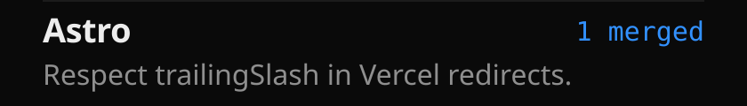</a>
<a href="https://github.com/traefik/traefik/pulls?q=is%3Apr+is%3Amerged+author%3Anikolas-sapa">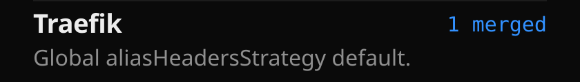</a>
<a href="https://github.com/eslint-stylistic/eslint-stylistic/pulls?q=is%3Apr+is%3Amerged+author%3Anikolas-sapa">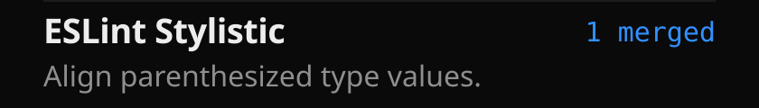</a>
<a href="https://github.com/unocss/unocss/pulls?q=is%3Apr+is%3Amerged+author%3Anikolas-sapa">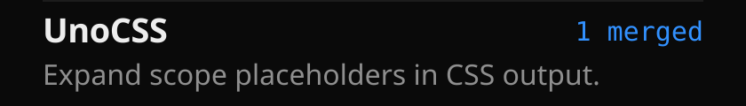</a>
<picture>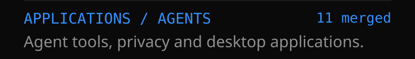</picture>
<a href="https://github.com/neatlogs/neatroots/pulls?q=is%3Apr+is%3Amerged+author%3Anikolas-sapa">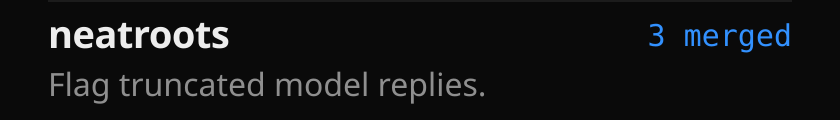</a>
<a href="https://github.com/CapSoftware/Cap/pulls?q=is%3Apr+is%3Amerged+author%3Anikolas-sapa">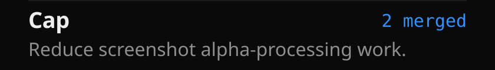</a>
<a href="https://github.com/BasedHardware/omi/pulls?q=is%3Apr+is%3Amerged+author%3Anikolas-sapa">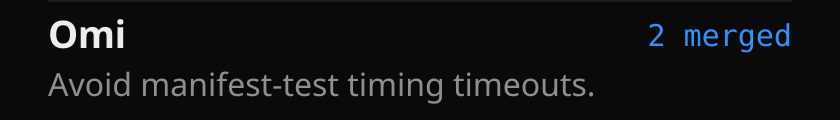</a>
<a href="https://github.com/data-privacy-stack/presidio/pulls?q=is%3Apr+is%3Amerged+author%3Anikolas-sapa">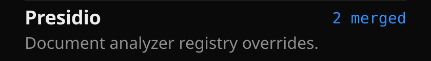</a>
<a href="https://github.com/mastra-ai/mastra/pulls?q=is%3Apr+is%3Amerged+author%3Anikolas-sapa">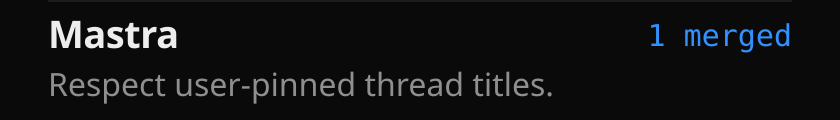</a>
<a href="https://github.com/stablyai/orca/pulls?q=is%3Apr+is%3Amerged+author%3Anikolas-sapa">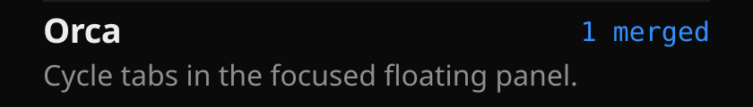</a>
<a href="https://github.com/get-convex/convex-auth/security/advisories/GHSA-c3rg-jwq9-3233">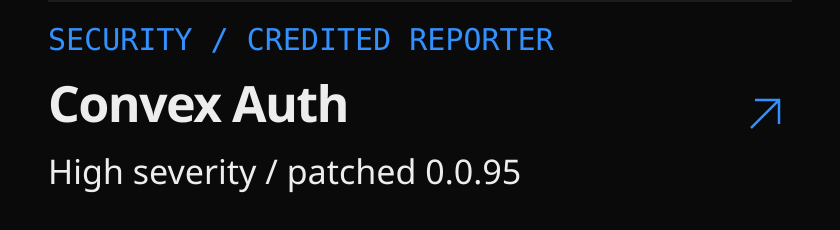</a>
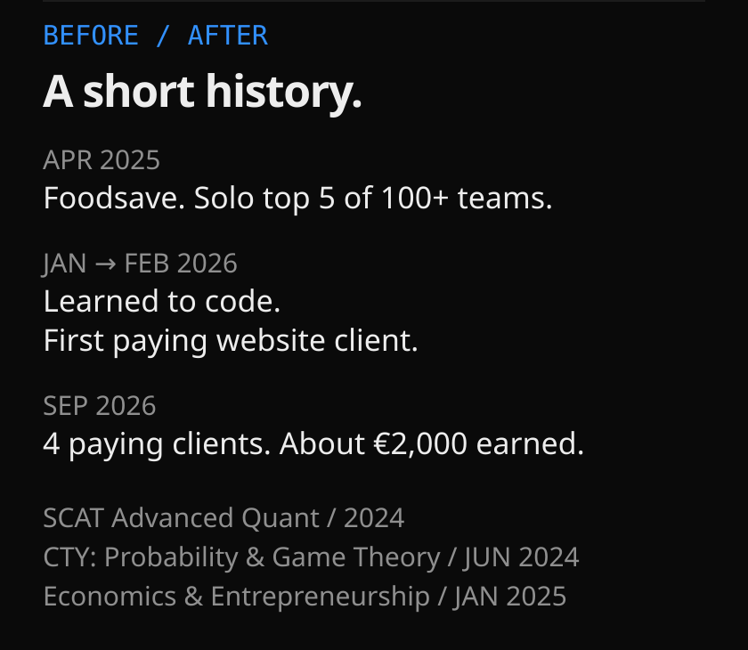
<a href="https://github.com/nikolas-sapa/nikolas-sapa/blob/main/EVIDENCE.md#counting-notes">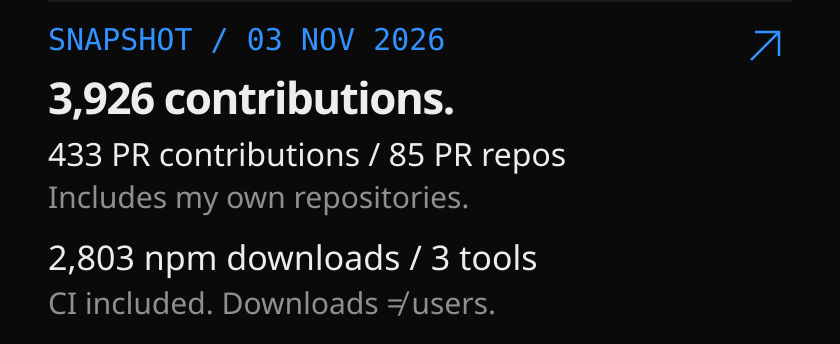</a>
<a href="https://nikolassapalidis.tech">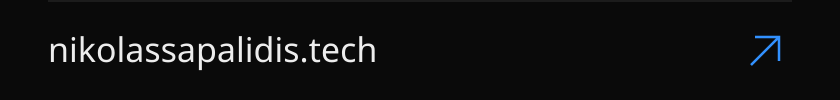</a>

