I'm Nikolas, a developer and marketer based in Greece. I build open-source tools for AI agents, publish benchmarks, and contribute fixes upstream.


My public work spans browser automation, developer tools, and agent reliability. Start with [Grip](https://github.com/nikolas-sapa/grip-browser), [ns-ui](https://github.com/nikolas-sapa/ns-ui), or my [agent reliability study](https://github.com/nikolas-sapa/resumed-agent-staleness).

### GitHub snapshot

Updated November 1, 2026. Contribution figures cover 2026; merged upstream PRs are all-time.

| Contributions | Pull requests opened | Repositories with PR contributions | Merged upstream PRs |
|---:|---:|---:|---:|
| 3,907 | 426 | 84 | [37](https://github.com/search?q=is%3Apr+author%3Anikolas-sapa+is%3Amerged+-user%3Anikolas-sapa&type=pullrequests) |

### Merged upstream work

| Project | Contribution |
|---|---|
| Astro | [Fix Vercel redirects with `trailingSlash: always/never` (#18085)](https://github.com/withastro/astro/pull/18085) |
| Traefik | [Add a global default for `aliasHeadersStrategy` (#13919)](https://github.com/traefik/traefik/pull/13919) |
| ESLint Stylistic | [Fix key-spacing alignment for parenthesized type values (#1283)](https://github.com/eslint-stylistic/eslint-stylistic/pull/1283) |
| Cap | [Optimize screenshot alpha checks, flattening, and premultiplication (#2673)](https://github.com/CapSoftware/Cap/pull/2673) |
| CapyMOA | [Add the EDDM drift detector (#422)](https://github.com/adaptive-machine-learning/CapyMOA/pull/422) |
| Presidio | [Preserve partial results when requested entities are unsupported (#2259)](https://github.com/data-privacy-stack/presidio/pull/2259) |

Credited reporter of [GHSA-c3rg-jwq9-3233](https://github.com/get-convex/convex-auth/security/advisories/GHSA-c3rg-jwq9-3233): a high-severity sign-in rate-limiting bypass in Convex Auth, patched in `0.0.95`.

---

### ns-ui — React components, installed as source

[](https://design.helpmarq.com)
[](https://github.com/nikolas-sapa/ns-ui/blob/main/LICENSE)
[](https://github.com/nikolas-sapa/ns-ui)

A shadcn-compatible registry of 542 React components, installed as source you own.
Includes a CLI and MCP server so coding agents can find and install components.

```bash
npx shadcn add https://design.helpmarq.com/r/gallery-coverflow-caustic.json
```

Tailwind v4 · Motion · react-three-fiber · agent-readable via `/llms.txt`.

**[Browse the registry](https://design.helpmarq.com)** · **[Source](https://github.com/nikolas-sapa/ns-ui)**

---

### Grip — the browser layer for AI agents

[](https://pypi.org/project/grip-browser/)
[](https://pypi.org/project/grip-browser/)
[](https://pypi.org/project/grip-browser/)
[](https://github.com/nikolas-sapa/grip-browser/blob/main/LICENSE)

A Python browser SDK built directly on Chrome DevTools Protocol. It gives agents
compact semantic snapshots, stable element references, shadow-DOM traversal,
and typed error recovery. No Playwright or Puppeteer dependency.

In the published eight-page benchmark (August 10, 2026), snapshots used a median
1,998 tokens. The median per-page reduction was 16× versus raw HTML and 5× versus
Playwright MCP. These measure snapshot size, not task success or end-to-end cost.

```bash
pip install grip-browser
```

The [benchmark data](https://github.com/nikolas-sapa/grip-browser/blob/main/benchmarks/RESULTS_COMPETITORS.md)
includes per-page results and methodology. The separate
[browser-use comparison](https://github.com/nikolas-sapa/grip-browser/blob/main/benchmarks/RESULTS_BROWSERUSE.md)
reports where its snapshots are smaller and explains the coverage differences.

**[PyPI](https://pypi.org/project/grip-browser/)** · **[Site + benchmarks](https://grip-browser.vercel.app)** · **[Source](https://github.com/nikolas-sapa/grip-browser)**

---

### Developer tools & AI infrastructure

| Project | What it does | Try it |
|---|---|---|
| [**branch-ai**](https://github.com/nikolas-sapa/branch-ai) | Reasoning canvas for AI CLIs — capture Claude Code / Codex / Gemini extended thinking as a navigable, forkable tree | `npm i -g branch-ai` · [demo](https://branchai-fawn.vercel.app) |
| [**skillswitch**](https://github.com/nikolas-sapa/skillswitch) | Manage AI-coding skills across Claude Code, Gemini CLI, Codex, Aider, Amp & Droid — stop 100 skills bloating your context window | `npm i -g skillswitch` · [site](https://skillswitch-landing.vercel.app) |
| [**clientcast**](https://github.com/nikolas-sapa/clientcast) | Turn Git commits into AI-drafted client updates; classify replies, flag scope creep, invoice flagged work via Stripe | `npm i -g clientcast` · [site](https://clientcast-landing.vercel.app) |
| [**toolfence**](https://github.com/nikolas-sapa/toolfence) | Security scanner for MCP servers — flags tool poisoning, prompt injection, drift, scope & cost before your agents connect | `npx toolfence <url>` · [site](https://mcpguard-site.vercel.app) |
| [**sigeval**](https://github.com/nikolas-sapa/sigeval) | pytest for LLMs that isn't flaky — significance-tested eval regression gates so you don't ship on noise | [docs](https://nikolas-sapa.github.io/sigeval/) |
| [**helm**](https://github.com/nikolas-sapa/helm) | Deploy + governance control plane for internal AI agents — ship an agent in one command; IT scopes its tools, caps token spend, kills it on demand | [site](https://helm-internal-agent-platform.vercel.app) |
| [**agentic-pipeline**](https://github.com/nikolas-sapa/agentic-pipeline) | Event-driven LLM request pipeline (Postgres queue, idempotent ingress, retry/DLQ/replay) — plus the benchmark that killed its own cost-routing feature | [repo](https://github.com/nikolas-sapa/agentic-pipeline) |
| [**x402-bounty-radar**](https://x402-bounty-radar.nikolas-sapalidis.workers.dev) | Paid API for real, funded GitHub bounties — scam-filtered, competition-scored, $0.01/call in USDC via x402, no key, no KYC | [live](https://x402-bounty-radar.nikolas-sapalidis.workers.dev) |

### Agent reliability research

[Resumed-agent staleness](https://github.com/nikolas-sapa/resumed-agent-staleness):
a pre-registered, 2,631-run study of agents acting on stale checkpoint summaries
after checking live data. Includes transcripts, analysis, and reproduction instructions.

In the tested setup, templated provenance summaries reduced stale writes;
provenance instructions for model-written compaction did not. The report separates
confirmed results from unconfirmed leads and documents scorer corrections.

<details>
<summary>More projects: web products, consumer apps, and on-chain experiments</summary>

### SaaS & web products

| Project | What it does | Live |
|---|---|---|
| [**neurolens**](https://github.com/nikolas-sapa/neurolens) (NeuroPulse) | Score any ad — image, video, or copy — across 8 brain regions before you spend a dollar promoting it. Open-source, self-hostable | [neurolens-nine.vercel.app](https://neurolens-nine.vercel.app) |
| **marketmyapp** | Marketing health score for indie founders — find out what's broken before your launch does | [marketmyapp.vercel.app](https://marketmyapp.vercel.app) |
| **creator-roast** | AI profile audit — scores, grades, and a ranked fix list to get brand-deal ready | [creator-roast.vercel.app](https://creator-roast.vercel.app) |
| **helpmarq** | Honest, structured project feedback from real users in 48 hours. Free tier | [helpmarq.com](https://helpmarq.com) |

### Consumer apps

| Project | What it does | Live |
|---|---|---|
| **noctiq** | AI sleep coach — reads HealthKit + Oura / WHOOP / Garmin and tells you exactly what to change | [noctiq-site.vercel.app](https://noctiq-site.vercel.app) |
| **padelup** | AI padel coaching — video analysis, training plans, court finder | [trypadelup.com](https://trypadelup.com) |
| **ugc-engine** | AI-UGC system — generate, score, and improve short-form video + carousels that learn from every post | [ugc-engine-site.vercel.app](https://ugc-engine-site.vercel.app) |

### On-chain

| Project | What it does | |
|---|---|---|
| [**sac-capital**](https://github.com/nikolas-sapa/sac-capital) | Verifiable AI trading agent — multi-stage LLM equity research with on-chain bytes32 commitments on Mantle, paper execution, full audit trail | [sapa-fund.vercel.app](https://sapa-fund.vercel.app) |
| [**curb**](https://github.com/nikolas-sapa/curb) | Your bank card has a daily limit, your wallet doesn't — a Monad vault that caps daily outflow: lowering is instant, raising is timelocked | [curb-pink.vercel.app](https://curb-pink.vercel.app) |

</details>

---

### Links

[Website](https://nikolassapalidis.tech) · [X @NikolasSapa](https://x.com/NikolasSapa)
